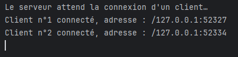
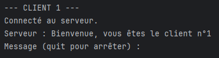
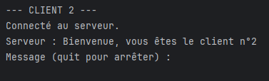
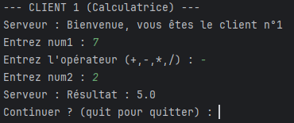
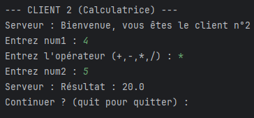
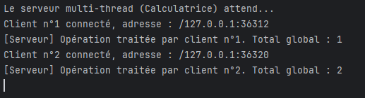

# TP 3 : Serveur Multi-threads - sockets en mode connecté TCP

---

# 🟢 Activité 3-1 : Acceptation de plusieurs clients

## 🎯 Objectif de l'activité
Transformer le serveur TCP simple en un **serveur multi-thread**. Le serveur doit gérer plusieurs clients simultanément, afficher l'adresse IP et le numéro d'ordre de chaque client, et renvoyer ce numéro au client.

## ⚙️ Fonctionnalités implémentées (Version 1)
- **Serveur Multi-thread** : Création d'un thread (`ClientProcess`) pour chaque client connecté.
- **Identification** : Affichage de l'adresse IP (`getRemoteSocketAddress()`) et attribution d'un numéro séquentiel (Client n°1, n°2, etc.).
- **Communication de base** : Envoi du message de bienvenue contenant le numéro d'ordre au client, et système d'écho pour les messages texte.

---

## 📝 Synthèse Activité 3-1
L'utilisation de threads (`new ClientProcess(socket, numero).start()`) permet de libérer la boucle principale du serveur (`while(true)`) immédiatement après l'acceptation d'une connexion. Ainsi, le serveur peut continuer à écouter sur le port 1234 pour de nouveaux clients, même si d'autres discussions sont en cours. Le compteur `numero` permet de différencier les clients, et la méthode `getRemoteSocketAddress()` permet de tracer l'origine réseau de chaque connexion.

---

## 📸 Captures d'écran (Activité 3-1)

### 1. Connexion de plusieurs clients au serveur
*Le serveur affiche l'adresse IP et le numéro d'ordre de chaque client qui se connecte.*

### 2. Réception du numéro d'ordre côté client
*Les clients reçoivent leur numéro d'ordre dès la connexion.*

---

---

# 🟢 Activité 3-2 : Amélioration de l'application calculatrice

## 🎯 Objectif de l'activité
Améliorer le serveur multi-thread pour intégrer un **service de calculatrice**. La communication passe désormais par des **objets** (sérialisation). De plus, un **compteur global synchronisé** est ajouté pour compter le nombre total d'opérations traitées par le serveur.

## ⚙️ Fonctionnalités implémentées (Version 2)
- **Communication par objets** : Utilisation de `ObjectInputStream` et `ObjectOutputStream` avec une classe `Operation` (Serializable).
- **Calculatrice** : Le serveur traite les additions, soustractions, multiplications et divisions envoyées par les clients.
- **Accès concurrent** : Un compteur global `operationsCounter` est incrémenté dans un bloc `synchronized (Server_MT.class)` pour éviter les conflits entre les threads.

---

## 📝 Synthèse Activité 3-2
Le passage de la communication texte à la communication par objets permet d'envoyer des structures de données complexes (ici, deux nombres et un opérateur). L'ajout du bloc `synchronized` est crucial : sans lui, si deux clients envoient une opération au même moment, les threads pourraient lire la même valeur du compteur en même temps et l'incrémenter de manière erronée, causant une "race condition". Le mot-clé `synchronized` garantit qu'un seul thread à la fois peut modifier le compteur.

---

## 📸 Imprimés d'écran (Activité 3-2)

### 1. Calculatrice en action
*Les clients envoient des opérations et reçoivent les résultats.*

### 2. Compteur global synchronisé
*Le serveur compte les opérations de manière sécurisée.*

